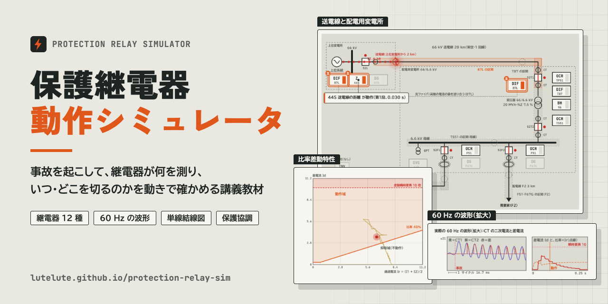
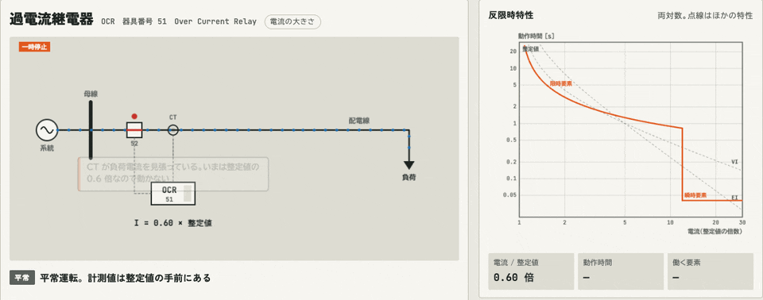
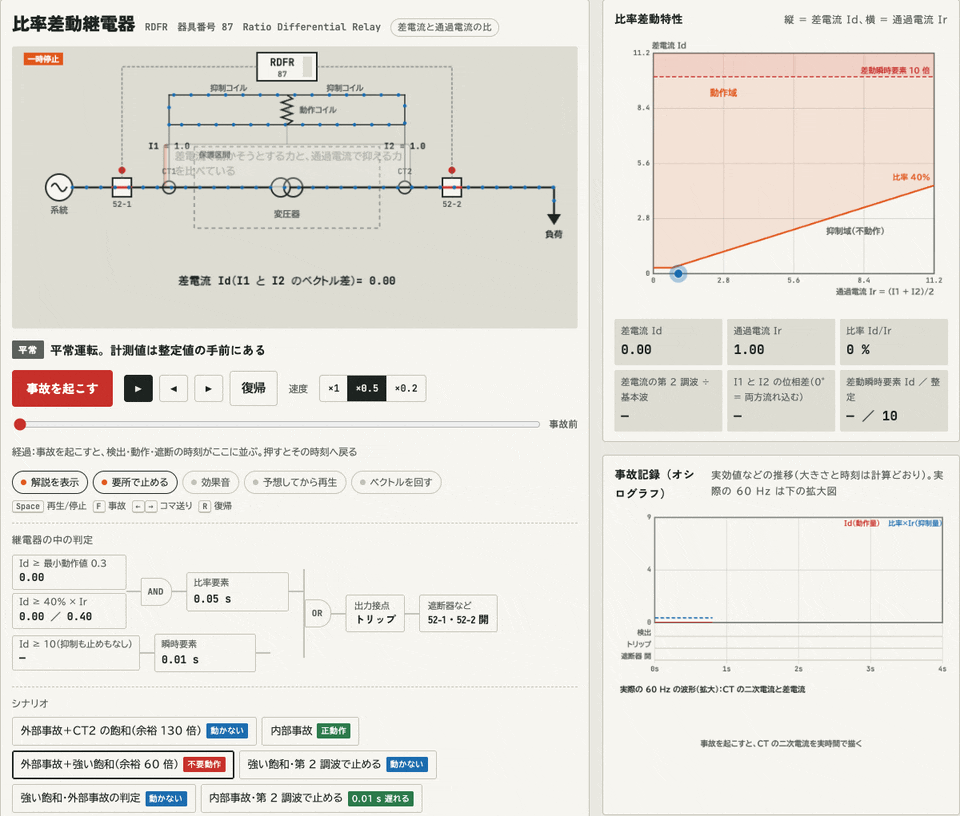
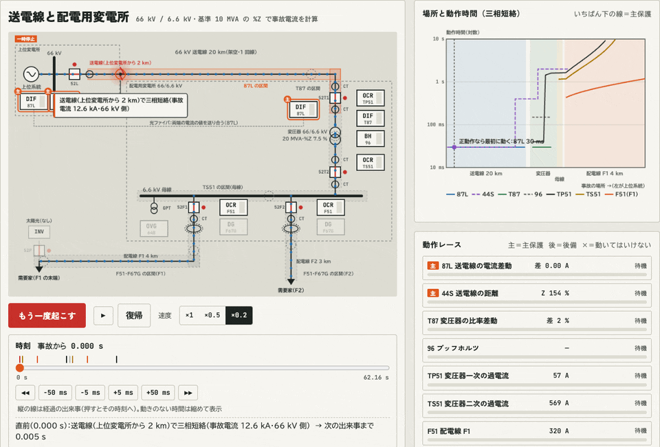

# 保護継電器 動作シミュレータ

保護継電器の動きをアニメーションで確かめる講義教材です。事故を起こして、継電器が何を測り、いつ、どこを切るのかを、電流の流れ・特性図・判定の論理・実際の 60 Hz の波形で追います。ブラウザで開くだけで動きます（1 枚の HTML、ライブラリなし）。

**▶ シミュレータを開く：https://lutelute.github.io/protection-relay-sim/**

## 動きの例

### 過電流継電器（OCR）：反限時特性

定格の 4 倍の短絡電流が流れると、右の図の縦線を点（経過時間）が上っていき、反限時曲線に届いた 1.49 s で動作して遮断器を開きます。電流を増やすと曲線が低くなり、瞬時要素の整定を超えると 0.04 s で動きます。

### 比率差動継電器（RDFR）：CT の飽和で外部事故なのに動く

外部事故の電流に直流分が重なると、CT2 の鉄心が飽和して二次電流が欠けます（右下の 60 Hz の拡大図）。欠けた分が差電流に見え、特性図の点が比率の斜線を越えて、0.08 s で不要動作します。同じ条件で「飽和を見つけて止める機能」（第 2 調波、外部事故の判定＋位相比較）を入れると止まります。差動瞬時要素と、CT1 も飽和する内部事故のシナリオもあります。

### 単線結線図（送電線と変電所）：永続事故と再閉路ロックアウト

66 kV 送電線の三相短絡で、87L（電流差動）と 44S（距離）の第 1 段が 0.03 s で動作し、0.08 s で遮断器が開きます。約 1 分後に再閉路しますが、事故が残っていたので再び切ってロックアウトします。右は事故の場所ごとの動作時間（いちばん下の線が主保護）と、装置ごとの動作レースです。下の時刻のスライダで、出来事ごとに戻って見られます。

## 中身

- **継電器ごとの動作**：OCR・OCGR・OVR・OVGR・UVR・DSR・DGR・DFR・RDFR・DR・FR・RPR の 12 種。結線図・特性図・判定ロジック図・オシログラフ風の記録で、事故の検出からトリップ、遮断までを追う。正動作・不動作・不要動作のシナリオ付き。オシログラフの大きさと時刻は計算どおりで、波（OCR・OCGR）は 2.5 Hz に落とした概念図。その下に、実際の 60 Hz の波形を拡大して描く（事故の瞬間の直流分は電圧の位相で変わり、遮断器は接点が開いたあとの電流零点で切れる）。短絡方向継電器（DSR）は、至近端の三相短絡で電圧がほぼ 0 になると向きを測れないことと、メモリ電圧（事故前の電圧を 0.1 s 覚える）で防ぐことを、電圧と電流の 60 Hz 波形で見せる。差動・比率差動は、CT の鉄心の磁束を 0.01 ms 刻みで計算し、直流分で CT2 が飽和して二次電流が欠け、差電流に見えて外部事故で不要動作するようすを、1 サイクルの DFT（ベクトルの差）で判定する。比率差動には、飽和を見つけて止める機能（差電流の第 2 調波で止める方式と、事故の直後 2 ms に差電流が出ないことから外部事故と判定し、I1 と I2 の位相比較で止めを外す方式）を付けた。外部事故の 0.1 s 後に区間の中でも事故が起きる「移行事故」で、位相比較がないと見逃すことも確かめられる。差動瞬時要素（差電流が整定以上なら、比率の抑制も止める機能も通さずに 0.01 s で動く）と、CT1 の飽和も付けた。区間の中の大事故で CT1 が飽和すると差電流に第 2 調波が出て、第 2 調波で止める方式では 0.19 s まで遅れる。瞬時要素なら、CT1 が飽和しきる前の最初の 1 サイクルのうちに切る。瞬時要素の整定を下げすぎると、強い飽和の外部事故で、止める機能に関係なく動いてしまうことも確かめられる。数式には、記号の意味・言葉での説明・いまの整定値を入れた計算を付けた。位相の図は基準を止めて描き、整定値の円と動作域を重ねる（「ベクトルを回す」で回転も見られる）。
- **単線結線図で見る（工場の高圧受電設備）**：6.6 kV の受電設備で事故を起こし、%Z 法（基準 10 MVA）で求めた事故電流と、MCCB・受電 OCR・PAS（SO・DGR）・変電所の F51/F67G・自家発の OVGR/UVR の時限協調を見る。
- **単線結線図（送電線と変電所）**：66 kV 送電線・配電用変電所（66/6.6 kV）・6.6 kV 配電線で事故を起こし、87L・44S（第 1〜3 段）・67G・T87・96・TP51・TS51・64B・F51・F67G の主保護と後備を見る。保護区間の帯と、事故の場所ごとの動作時間の階段図（いちばん下の線が主保護）。変圧器の層間短絡、励磁突入（第 2 高調波抑制）、遮断器の不動作、整定ミス、高抵抗地絡、再閉路とロックアウトのシナリオ付き。太陽光（INV）を配電線の末端につなぐと、事故電流の頭打ちとゲートブロック、ほかの配電線の事故での運転継続（FRT）、単独運転とその検出（UVR・OVR・OFR・UFR・OVGR、受動的方式・能動的方式）、有効電力（出力÷負荷）と無効電力（負荷の力率）の 2 軸で見る不感帯、転送遮断、線路無電圧確認装置と非同期投入のおそれを見られる。単独運転のモデル（位相の跳躍＝負荷の力率角、能動的方式の周波数の動き、整定）は教材用の仮定で、ページ内の「計算の前提」に書いている。
- **正動作なら・経過から飛ぶ**：両方の単線結線図で、選んだ事故で動くべき装置（主保護・後備・動いてはいけない装置）といまの整定での動作時間を示し、実際の動きと比べて判定する。事故の経過の行を押すと、その時刻へ戻って止まる。「戻るまで」のものさし（対数軸）に、遮断・再閉路・復電・ロックアウトの経過と、そのあとの復旧の目安（数十分〜数週間）を並べる。継電器のタブでも、経過の札やオシログラフを押すとその時刻へ飛ぶ。
- **スライダで細かく調べる**：両方の単線結線図に時刻のスライダを付けた。同じ条件で最後まで計算しておき、好きな時刻の状態に戻す（← → で 5 ms ずつ、Shift で 50 ms、出来事ごとに飛ぶボタンも）。動きのない時間（再閉路を待つあいだなど）はスライダの上で縮める。送電線と変電所の図では、事故点の位置（km。図の線を押してもよい）、三相短絡の事故抵抗、44S 第 1 段の到達、TP51 のレバー、T87 の第 2 高調波抑制の整定、F51 の電流整定、F67G・64B の V0 整定、INV の UVR の整定と時限、受動的方式の整定、負荷の力率を動かせる。工場の図では、地絡抵抗、PAS の地絡継電器の I0 整定と動作時間、変電所 F51 のレバーを足した。止めたまま整定を変えると、同じ時刻の状態を新しい整定で計算し直す。
- **抜け穴と組み合わせ**：継電器ごとに、特性の形の理由（その領域は不要動作を避けるためか、協調のためか、物理的に見えないのか）と、検出できない事故（事故抵抗・接地抵抗・雷・INV など）を整理。事故の種類 × 装置のカバー表と、設置の組み合わせの例。
- **モデル化と解析**：見たい時間で解析の方法が決まる「時間の地図」と、発電機（X''d・X'd・Xd、動揺方程式）・負荷（ZIP、電動機）・線路（R を無視した誤差、地絡の C）・INV（事故電流の頭打ち、慣性、FRT）を動かして確かめる図。%Z 法の例題、計算の手順とツール。
- **器具番号**：JEM 1090 の器具番号表と、補助記号・保護対象の英字の組み立て。

## 使い方

- 上のタブで図を選びます：継電器ごとの動作／12 種を見比べる／単線結線図（工場の受電設備）／単線結線図（送電線と変電所）／抜け穴と組み合わせ／モデル化と解析。
- 「事故を起こす」か、シナリオのボタンを押します。ボタンの札（正動作・動かない・不要動作など）は、そのシナリオで起きることです。「予想してから再生」をオンにすると、事故の前に結果を予想してから見られます。
- スライダで整定や条件を変えられます。止めたまま変えると、同じ時刻の状態を新しい条件で計算し直します。
- キー操作：Space 再生／停止、F 事故、← → コマ送り、R 復帰。
- URL の末尾に付けると、その図から開きます：`#ocr`・`#dsr`・`#rdfr`・`#dr` など（継電器の略号の小文字）、`#all`（12 種を見比べる）、`#sld`（工場の受電設備）、`#grid`（送電線と変電所）、`#gaps`（抜け穴と組み合わせ）、`#model`（モデル化と解析）。

## ファイル

- `index.html`：シミュレータの本体（1 枚の HTML。外から読むのは Google Fonts だけ）
- `assets/`：この README とリンクのプレビューに使う画像（バナーと GIF）

## 注意

整定値・動作時間はアニメーション用の代表例です。実機の整定は保護協調計算で決めてください。継電器は瞬時復帰、波形は概念図です。再閉路は約 1 分後の実時間で、待つあいだに何も変わらなければ早送りします（前提はページ内の「計算の前提」に書いています）。
